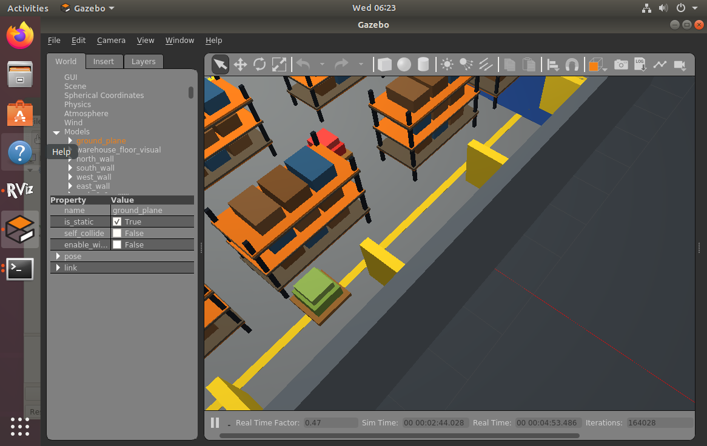
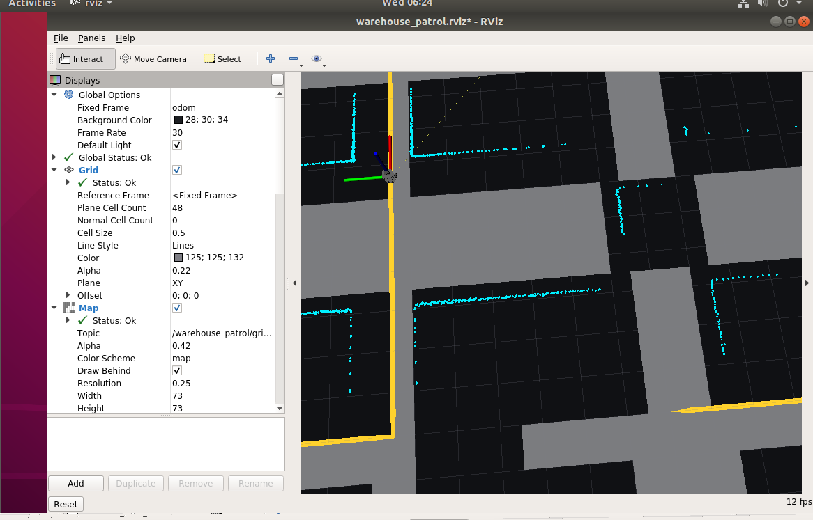

# 仓库巡逻机器人仿真系统（ROS + Gazebo + TurtleBot3）

基于 **ROS Melodic + Gazebo 9** 的仓库自主巡逻机器人仿真项目。机器人（TurtleBot3 Burger）在自
建的仓库场景中，依靠激光雷达与里程计数据，通过 **A\* 全局路径规划**完成多检查点自主巡逻，并
在 RViz 中实时可视化机器人、雷达点、占据栅格地图与规划路径。

> 作者：刘奥、唐良茂、廖阳光

---

## 演示视频

[▶ 点击观看完整演示视频（media/demo.mp4）](media/demo.mp4)

> 说明：点击后在 GitHub 页面可直接在线播放；也可点右上角 `Download` 下载原视频。

## 运行效果截图

**Gazebo 仓库场景**



**RViz 巡逻可视化**



---

## 一、项目简介

主要功能：

1. **仓库场景建模**：地面、四周墙壁、货架与货物、独立障碍物、工业灰/橙配色与光照。
2. **机器人差速驱动**：通过 Gazebo 差速插件接收 `/cmd_vel`，发布 `/odom` 与 TF。
3. **激光雷达传感器**：2D 激光雷达，发布 `/scan`。
4. **A\* 全局路径规划**：发布全局路径（`/warehouse_patrol/global_path`）与占据栅格地图（`/warehouse_patrol/grid_map`）。
5. **巡逻控制状态机**：按检查点顺序巡逻，支持启动/暂停/继续/停止、循环巡逻。
6. **标准 ROS 接口**：话题 + 服务 + 动作（Action）。
7. **RViz 可视化**：深色背景、高对比雷达点与路径。

## 二、运行环境要求

| 项目 | 要求 |
| --- | --- |
| 操作系统 | Ubuntu 18.04.6 LTS（64 位） |
| ROS 版本 | ROS Melodic（`/opt/ros/melodic`） |
| 仿真器 | Gazebo 9 |
| 机器人 | TurtleBot3 Burger |
| 工作空间 | `~/catkin_ws` |

依赖的 ROS 包：

```
gazebo_ros  gazebo_msgs  robot_state_publisher  xacro  urdf  tf  rviz
rospy  roscpp  std_msgs  sensor_msgs  geometry_msgs  nav_msgs
actionlib  actionlib_msgs  message_generation  message_runtime
```

如需安装：

```bash
sudo apt update
sudo apt install ros-melodic-gazebo-ros ros-melodic-gazebo-ros-pkgs \
                 ros-melodic-robot-state-publisher ros-melodic-xacro \
                 ros-melodic-rviz ros-melodic-turtlebot3-msgs
```

> 说明：仓库内已附带 `turtlebot3_description / turtlebot3_gazebo / turtlebot3_msgs`
> 三个依赖包源码，即使系统未安装 turtlebot3 的仿真包也可以直接编译运行。

## 三、仓库结构

```
.
├── README.md                本说明文档
├── src/                     全部 ROS 包源码（catkin 工作空间）
│   ├── warehouse_patrol_v2      项目主包：仓库场景、仿真启动、RViz 配置
│   ├── warehouse_patrol_bot     项目主包：A* 规划核心、巡逻控制、msg/srv/action
│   ├── turtlebot3_description   依赖：机器人 URDF/Xacro 模型与三维网格
│   ├── turtlebot3_gazebo        依赖：TurtleBot3 Gazebo 模型库与官方世界
│   ├── turtlebot3_msgs          依赖：TurtleBot3 消息/服务定义
│   ├── learning_launch          课程练习：ROS launch 文件
│   ├── learning_parameter       课程练习：ROS 参数
│   ├── learning_service         课程练习：ROS 服务
│   ├── learning_tf              课程练习：ROS 坐标变换
│   ├── learning_topic           课程练习：ROS 话题
│   └── test_pkg                 课程练习：测试包
├── media/                   演示视频与运行截图
│   ├── demo.mp4                 完整演示视频
│   ├── gazebo_warehouse.png     Gazebo 场景截图
│   └── rviz_navigation.png      RViz 可视化截图
└── acceptance_logs/         仿真运行的验收日志、数据采样与截图
```

### 3.1 项目主包 `warehouse_patrol_v2`

| 文件 | 作用 |
| --- | --- |
| `worlds/complex_warehouse.world` | **仓库 Gazebo 场景**：地面、墙壁、货架（深灰立柱 + 橙色层板）、货箱、障碍物、光照、相机 |
| `launch/simulation.launch` | **仿真启动**：加载世界、展开机器人模型、启动 `robot_state_publisher`、生成 TurtleBot3。参数：`gui / headless / use_rviz / x / y / z` |
| `launch/patrol.launch` | **项目总入口**：包含 `simulation.launch`，并启动导航核心、巡逻管理器与 RViz。参数：`gui / headless / use_rviz / autostart / loop_patrol / x / y` |
| `launch/lidar_test.launch` | 备用：仅用简化雷达模型做雷达数据测试 |
| `rviz/lidar.rviz` | 雷达测试用的 RViz 配置 |
| `scripts/patrol_controller.py` | 备用方案：基于 `/scan` 的简易避障巡逻控制器 |
| `urdf/lidar_sensor.xacro` | 简化“车体 + 激光雷达”模型，仅用于 `lidar_test.launch` |

### 3.2 项目主包 `warehouse_patrol_bot`

| 文件 | 作用 |
| --- | --- |
| `msg/PatrolStatus.msg` | 巡逻状态消息 |
| `srv/PatrolControl.srv` | 巡逻控制服务（start/pause/resume/stop） |
| `action/Patrol.action` | 巡逻动作定义 |
| `scripts/warehouse_navigation_core.py` | **A\* 规划核心**：发布 `/warehouse_patrol/grid_map` 与 `/warehouse_patrol/global_path` |
| `scripts/warehouse_unified_navigation.py` | **统一巡逻控制器**：发布 `/cmd_vel`、`/warehouse_patrol/status`、`/warehouse_patrol/state`，提供服务与动作 |
| `scripts/spawn_turtlebot3_if_needed.py` | **安全生成机器人**：先检查是否已存在，避免重复生成；使用根命名空间 `/` 保证 TF 与 `/joint_states` 正确挂载 |
| `scripts/patrol_manager.py` / `patrol.py` / `maze_patrol.py` / `obstacle_avoidance.py` | 早期版本的控制/避障节点（保留备查） |
| `scripts/maze_core.py` / `build_maze_gazebo.py` | 迷宫生成与 A\* 算法、迷宫落位 |
| `scripts/build_warehouse.sh` / `start_project.sh` | 早期建场景 / 一键启动脚本 |
| `scripts/diagnose_warehouse.sh` | **一键诊断脚本**：检查节点、话题、服务、TF |
| `launch/patrol.launch` / `patrol_manager.launch` / `warehouse_demo.launch` | 早期启动文件 |
| `rviz/warehouse_patrol.rviz` | **当前主用 RViz 配置**（深色背景、青色雷达、黄色路径、栅格地图） |
| `rviz/lidar_final.rviz` | 备用 RViz 配置 |
| `urdf/warehouse_robot.urdf` | 早期机器人模型 |
| `docs/PROJECT_STATUS.md` | 包的集成说明与验证边界记录 |

### 3.3 依赖包

| 包 | 关键内容 |
| --- | --- |
| `turtlebot3_description` | `urdf/turtlebot3_burger.urdf.xacro`（主模型）、`urdf/turtlebot3_burger.gazebo.xacro`（差速/IMU/激光插件，话题用绝对路径 `/cmd_vel`、`/odom`、`/scan`）、`meshes/` 网格 |
| `turtlebot3_gazebo` | `models/` 模型库、`worlds/` 官方世界、`launch/` 官方启动文件 |
| `turtlebot3_msgs` | 消息与服务定义 |

## 四、编译

```bash
# 1. 把 src/ 放到 catkin 工作空间中
mkdir -p ~/catkin_ws/src
cp -r src/* ~/catkin_ws/src/

# 2. 编译
source /opt/ros/melodic/setup.bash
cd ~/catkin_ws
catkin_make

# 3. 配置环境
source devel/setup.bash
export TURTLEBOT3_MODEL=burger
```

> 建议把以下三行写入 `~/.bashrc`，之后的终端无需重复输入：
> ```bash
> source /opt/ros/melodic/setup.bash
> source ~/catkin_ws/devel/setup.bash
> export TURTLEBOT3_MODEL=burger
> ```

## 五、运行

### 5.1 推荐方式（一条命令启动全部）

```bash
source /opt/ros/melodic/setup.bash
source ~/catkin_ws/devel/setup.bash
export TURTLEBOT3_MODEL=burger
roslaunch warehouse_patrol_v2 patrol.launch
```

该命令会依次启动：Gazebo 仓库场景 → 机器人 → A\* 规划核心 → 巡逻控制器 → RViz。

### 5.2 常用参数

| 参数 | 默认值 | 含义 |
| --- | --- | --- |
| `gui` | `true` | 是否显示 Gazebo 图形界面 |
| `headless` | `false` | 无头模式（配合 `gui:=false`） |
| `use_rviz` | `true` | 是否启动 RViz |
| `autostart` | `true` | 启动后是否自动开始巡逻 |
| `loop_patrol` | `true` | 是否循环巡逻 |
| `x` / `y` | `-7.0` / `0.0` | 机器人初始位置（仓库西侧入口） |

示例（无界面运行，仅跑逻辑与数据）：

```bash
roslaunch warehouse_patrol_v2 patrol.launch gui:=false headless:=true use_rviz:=false
```

### 5.3 分步启动（便于观察单个模块）

```bash
# 终端 1：仅启动仿真世界与机器人
roslaunch warehouse_patrol_v2 simulation.launch gui:=true use_rviz:=false

# 终端 2：启动 A* 规划核心
rosrun warehouse_patrol_bot warehouse_navigation_core.py

# 终端 3：启动巡逻控制器
rosrun warehouse_patrol_bot warehouse_unified_navigation.py _autostart:=true _loop_patrol:=true

# 终端 4：启动 RViz（可选）
rosrun rviz rviz -d $(rospack find warehouse_patrol_bot)/rviz/warehouse_patrol.rviz
```

### 5.4 停止

在启动 `roslaunch` 的终端按 `Ctrl+C` 即可正常关闭全部节点。

## 六、常用操作指令

### 6.1 查看节点与话题

```bash
rosnode list                 # 已运行节点
rostopic list                # 所有话题
rostopic info /scan          # 某话题的发布者/订阅者/消息类型
```

### 6.2 查看实时数据

```bash
rostopic echo /odom/pose/pose/position       # 机器人当前位置
rostopic echo /scan/header                   # 雷达数据帧信息
rostopic echo /warehouse_patrol/status       # 巡逻状态（航点索引等）
rostopic echo /warehouse_patrol/state        # 巡逻状态字符串

rostopic hz /scan        # 雷达发布频率（约 8~10 Hz）
rostopic hz /odom        # 里程计频率（约 30 Hz）
```

### 6.3 服务调用（启动/暂停/继续/停止）

```bash
rosservice list | grep warehouse_patrol
rosservice call /warehouse_patrol/control "command: start"
rosservice call /warehouse_patrol/control "command: pause"
rosservice call /warehouse_patrol/control "command: resume"
rosservice call /warehouse_patrol/control "command: stop"
```

### 6.4 动作（Action）调用

```bash
rosrun actionlib axclient.py /warehouse_patrol/patrol
rostopic echo /warehouse_patrol/patrol/feedback
rostopic echo /warehouse_patrol/patrol/result
```

### 6.5 TF 与机器人状态检查

```bash
rosrun tf tf_echo odom base_scan
rosrun tf view_frames
rosservice call /gazebo/get_model_state "{model_name: 'turtlebot3_burger'}"
```

### 6.6 一键诊断

```bash
bash ~/catkin_ws/src/warehouse_patrol_bot/scripts/diagnose_warehouse.sh
```

## 七、ROS 接口一览

### 7.1 话题（Topics）

| 话题 | 类型 | 说明 |
| --- | --- | --- |
| `/cmd_vel` | `geometry_msgs/Twist` | 速度指令（Gazebo 差速插件订阅） |
| `/odom` | `nav_msgs/Odometry` | 里程计位姿（frame: `odom`） |
| `/scan` | `sensor_msgs/LaserScan` | 激光雷达数据（frame: `base_scan`） |
| `/tf` | `tf2_msgs/TFMessage` | 坐标变换树 |
| `/joint_states` | `sensor_msgs/JointState` | 关节状态 |
| `/warehouse_patrol/global_path` | `nav_msgs/Path` | A\* 全局路径（frame: `odom`） |
| `/warehouse_patrol/grid_map` | `nav_msgs/OccupancyGrid` | 占据栅格地图（frame: `odom`） |
| `/warehouse_patrol/status` | `warehouse_patrol_bot/PatrolStatus` | 巡逻状态 |
| `/warehouse_patrol/state` | `std_msgs/String` | 巡逻状态字符串 |

### 7.2 服务与动作

| 接口 | 类型 | 说明 |
| --- | --- | --- |
| `/warehouse_patrol/control` | `warehouse_patrol_bot/PatrolControl` | 传入 `command`：start / pause / resume / stop |
| `/warehouse_patrol/patrol` | `warehouse_patrol_bot/Patrol` | 巡逻动作，goal 中 `repeat` 控制是否循环 |

### 7.3 坐标变换 TF 树

```
odom ──► base_footprint ──► base_link ──► base_scan（激光雷达）
```

固定坐标系（Fixed Frame）推荐使用 `odom`。

## 八、RViz 可视化说明

```bash
rosrun rviz rviz -d $(rospack find warehouse_patrol_bot)/rviz/warehouse_patrol.rviz
```

| 显示项 | 话题 | 说明 |
| --- | --- | --- |
| Grid | — | 参考网格 |
| Map | `/warehouse_patrol/grid_map` | A\* 占据栅格地图（半透明） |
| Path | `/warehouse_patrol/global_path` | A\* 全局路径（黄色） |
| LaserScan | `/scan` | 雷达点（青色，Size 3 px，Decay 0.25 s） |
| RobotModel | `robot_description` | 机器人模型 |
| TF | — | 坐标轴 |

- Fixed Frame：`odom`；背景色：深灰（28, 30, 34）。
- 若画面为空，先检查 RViz 左上角 `Global Status` 是否为 `Ok`，以及 `Fixed Frame` 是否正确。

## 九、常见问题排查

1. **Gazebo 图形界面崩溃（VMware 虚拟机环境）**
   ```bash
   export LIBGL_ALWAYS_SOFTWARE=1
   export QT_X11_NO_MITSHM=1
   export SVGA_VGPU10=0
   roslaunch warehouse_patrol_v2 patrol.launch
   ```
   > 软件渲染会使仿真速度慢于真实时间，属正常现象。

2. **机器人被重复生成 / 提示模型已存在**
   ```bash
   rosservice call /gazebo/delete_model "{model_name: 'turtlebot3_burger'}"
   ```

3. **RViz 报 `Fixed Frame ... does not exist` 或 TF 报错**
   确认使用本包自带的 `spawn_turtlebot3_if_needed.py`（`robot_namespace = "/"`），并检查：
   ```bash
   rosrun tf tf_echo odom base_scan
   ```

4. **`/scan` 无数据**
   ```bash
   rostopic hz /scan
   rostopic info /scan
   ```

5. **`rostopic: command not found`**
   ```bash
   source /opt/ros/melodic/setup.bash
   source ~/catkin_ws/devel/setup.bash
   ```

6. **机器人乱动**
   不要同时运行多个发布 `/cmd_vel` 的节点（`warehouse_unified_navigation.py`、
   `patrol.py`、`maze_patrol.py`、`patrol_controller.py`），只能保留一个。

## 十、数据流（各文件协作关系）

```
patrol.launch（总入口）
 ├── simulation.launch ................ 启动仿真
 │    ├── gazebo_ros/empty_world.launch + complex_warehouse.world  加载仓库场景
 │    ├── robot_description ← xacro 展开 turtlebot3_burger.urdf.xacro（含 .gazebo.xacro 插件）
 │    ├── robot_state_publisher ........ 发布 TF
 │    └── spawn_turtlebot3_if_needed.py  生成唯一机器人实例
 ├── warehouse_navigation_core.py ...... A* 规划 → /warehouse_patrol/global_path + /grid_map
 ├── warehouse_unified_navigation.py ... 巡逻控制 → /cmd_vel，发布 status/state，提供 service/action
 └── rviz .............................. warehouse_patrol.rviz 可视化

运行时数据流：
/scan + /odom + /tf → 规划核心 → global_path / grid_map → 巡逻控制器 → /cmd_vel
        → Gazebo 差速插件 → 机器人运动 → /odom 更新 → 回到规划核心（闭环）
```

## 十一、验收记录

`acceptance_logs/` 内保存了实际运行的验收证据，其中
`visual_final_20261028_055557/` 目录包含：

- `ACCEPTANCE.md`：验收结论（含已通过项与未通过项）
- `verification.json`：遥测数据（位移、`/scan` 频率、TF 误差、路径落入占据格数量等）
- 实际运行的 Gazebo / RViz 可见窗口截图
- `backups.txt`：修改前备份记录
